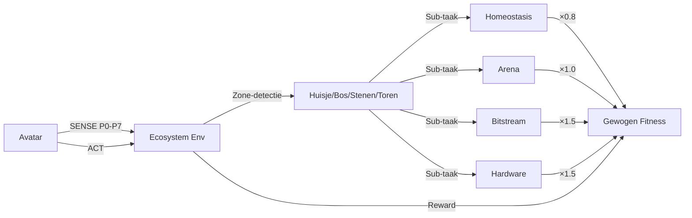

# Requirements

### Overview
Een 5de lab-test "Ecosysteem" waar de avatar op een 24×24 grid navigeert door een bos met 4 zones. De avatar ontvangt altijd alle 4 soorten sensoren, maar de huidige zone bepaalt welke sub-taak getraind wordt. Moeilijke taken krijgen zwaardere beloning, makkelijke taken lichtere.

### Zones
| Zone | Positie (24×24) | Sub-taak | Beloningsgewicht | Acties |
|---|---|---|---|---|
| 🏠 Huisje | Links-boven (0-7, 0-7) | Homeostasis | ×0.8 | 0:Rust, 1:Werk, 2:Turbo, 3:Koelen |
| 🌲 Bos | Rechts-boven (16-23, 0-7) | Arena (energiebronnen) | ×1.0 | 0:Noord, 1:Oost, 2:Zuid, 3:West |
| 🪨 Puzzelstenen | Links-onder (0-7, 16-23) | Bitstream | ×1.5 | 0-15: 4-bit voorspelling |
| 📡 Sensor-toren | Rechts-onder (16-23, 16-23) | Hardware-bus | ×1.5 | 0-15: 4-bit voorspelling |

### Sensor-input (altijd actief)
- P0-P3: Zone-specifieke sensoren (afhankelijk van huidige zone)
- P4-P7: Algemene sensoren (energy, tick, zone-ID, huisje-richting)

### Fitness
- Fitness = gewogen som van alle sub-scores per tick
- Navigatie naar huisje wordt beloond (terugkeer-mechanisme)
- Energie vermindert per tick; avatar sterft bij energy ≤ 0

### Rendering
- Blaxxun Interactive stijl: lichte pseudo-3D/isometrische rendering op 2D canvas
- Geen WebGL — gewoon canvas 2D met eenvoudige geometrie
- Pentium 3 compatible: geen zware berekeningen

# Technical Design

### Current Implementation
- `machineVm.ts`: `TaskId` type (regel 115), `TASKS` record (125), `EnvSnapshot` (226), `createInitialEnv` (890), `updateEnvPorts` (954), `stepEnvironment` (1040)
- Alle 4 taken gebruiken `if/else if` blokken in `stepEnvironment` en `updateEnvPorts`
- `ArenaCanvas.tsx`: 2D canvas rendering voor arena (340 regels)

### Key Decisions
1. **Nieuwe TaskId**: `'ecosystem'` toegevoegd aan `TaskId` type en `TASKS` record
2. **Zone-detectie**: Gebaseerd op avatar positie (x, y) op 24×24 grid
3. **Gewogen beloning**: Homeostasis ×0.8, Arena ×1.0, Bitstream ×1.5, Hardware ×1.5
4. **Altijd alle sensoren**: P0-P3 zijn zone-specifiek, P4-P7 zijn algemeen (energy, tick, zone-ID, huisje-richting)
5. **Terugkeer naar huisje**: Extra beloning wanneer avatar naar huisje-zone navigeert
6. **Rendering**: Nieuwe `EcosystemCanvas.tsx` component met isometrische 2D canvas rendering

### Proposed Changes

**`machineVm.ts`:**
- `TaskId` type uitbreiden met `'ecosystem'`
- `TASKS['ecosystem']` toevoegen met gecombineerde sensor-ports
- `EnvSnapshot` uitbreiden met: `ecosystemZone`, `ecosystemHousePos`, `ecosystemEnergyNodes`, `ecosystemBitPattern`, `ecosystemHwSignal`
- `createInitialEnv`: nieuwe `if (taskId === 'ecosystem')` blok
- `updateEnvPorts`: nieuwe `if (env.taskId === 'ecosystem')` blok met zone-afhankelijke P0-P3 + algemene P4-P7
- `stepEnvironment`: nieuwe `if (env.taskId === 'ecosystem')` blok met:
  - Zone-detectie op basis van avatar positie
  - Sub-taak evaluatie (homeostasis/arena/bitstream/hardware)
  - Gewogen beloning
  - Energie vermindering per tick
  - Terugkeer-naar-huisje beloning

**`EcosystemCanvas.tsx` (nieuw):**
- 2D canvas met isometrische rendering
- 24×24 grid met 4 gekleurde zones
- Avatar als eenvoudige kubus (pseudo-3D)
- Huisje, bomen, puzzelstenen, sensor-toren als eenvoudige vormen
- Trail van avatar
- Energiebronnen als groene stippen

**`App.tsx`:**
- `'ecosystem'` toevoegen aan task selector
- `EcosystemCanvas` tonen bij `taskId === 'ecosystem'`

**`README.md`:**
- Ecosysteem taak toevoegen aan changelog

### Architecture Diagram

### File Structure
- `src/engine/machineVm.ts` — modified (ecosystem taak toegevoegd)
- `src/components/EcosystemCanvas.tsx` — new (isometrische 2D canvas renderer)
- `src/App.tsx` — modified (ecosystem task selector + canvas)
- `README.md` — modified (changelog update)

# Delivery Steps

### ✓ Step 1: Ecosystem taak in machineVm.ts
Voeg de 'ecosystem' taak toe aan de VM-engine met zone-gebaseerde sub-taken en gewogen beloning.
- `TaskId` type uitbreiden met `'ecosystem'`
- `TASKS['ecosystem']` toevoegen met gecombineerde sensor-ports
- `EnvSnapshot` uitbreiden met ecosystem-specifieke velden (zone, huisje-positie, energiebronnen, bit-patroon, hw-signaal)
- `createInitialEnv`: ecosystem setup met 24×24 grid, 4 zones, huisje, energiebronnen
- `updateEnvPorts`: zone-afhankelijke P0-P3 + algemene P4-P7 (energy, tick, zone-ID, huisje-richting)
- `stepEnvironment`: zone-detectie, sub-taak evaluatie, gewogen beloning (×0.8/×1.0/×1.5/×1.5), energie vermindering, terugkeer-naar-huisje beloning
- TypeScript compilatie verifiëren ✓

### ✓ Step 2: EcosystemCanvas renderer en App integratie
Nieuwe canvas renderer voor het ecosysteem en integratie in de hoofd-UI.
- `EcosystemCanvas.tsx`: isometrische 2D canvas rendering met 24×24 grid, 4 gekleurde zones, avatar als kubus, huisje, bomen, puzzelstenen, sensor-toren, trail, energiebronnen ✓
- `App.tsx`: 'ecosystem' toevoegen aan task selector, EcosystemCanvas tonen bij ecosystem-taak ✓
- `README.md`: ecosystem taak toevoegen aan changelog ✓
- TypeScript compilatie verifiëren ✓